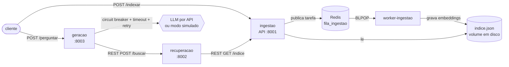

# C2.A2 - RAG Distribuido em Microsservicos

Sistemas Distribuidos e Computacao em Nuvem - FAESA 2026/2

Grupo 9 (individual): Lucas Xavier

Sistema de perguntas e respostas sobre os documentos da pasta `documentos/`, dividido
em tres microsservicos independentes. Feito em cima do kit da disciplina
(`sd-2026-2-kit-c2a2`).

## Arquitetura



Versao texto, caso o mermaid nao renderize:

```
cliente -> ingestao (8001) -> [fila Redis] -> worker-ingestao -> indice.json
cliente -> geracao (8003) -> recuperacao (8002) -> ingestao (8001) /indice
                geracao -> [circuit breaker] -> LLM
```

### Os servicos

| Pasta | Servico | O que faz |
|---|---|---|
| `servicos/ingestao/app.py` | Ingestao (API) | Recebe os documentos e so publica na fila. Responde 202 na hora com o id da tarefa. Tambem expoe o indice (`GET /indice`) pra recuperacao. |
| `servicos/ingestao/worker.py` | Worker de ingestao | Processo separado que consome a fila, quebra os textos em trechos, gera os embeddings (TF-IDF do kit) e salva o indice em disco. |
| `servicos/recuperacao/app.py` | Recuperacao | Busca o indice na ingestao, vetoriza a pergunta e devolve os top_k trechos por similaridade do cosseno. |
| `servicos/geracao/app.py` | Geracao | Chama a recuperacao, monta o prompt com os trechos e chama o LLM. A chamada ao LLM e protegida. |
| `servicos/comum/` | Codigo compartilhado | Embeddings, cliente do LLM, circuit breaker e helpers da fila. |

Cada servico tem o proprio `Dockerfile` e roda em um container separado. Eles so
conversam pela rede (REST) ou pela fila, nenhum importa codigo do outro (so o `comum`).

### Comunicacao

- **REST**: geracao -> recuperacao (`POST /buscar`) e recuperacao -> ingestao (`GET /indice`).
- **Mensageria (Redis)**: a etapa de indexacao passa pela fila `fila_ingestao`. A API
  publica com `RPUSH` e o worker consome com `BLPOP`. Se o worker estiver fora do ar a
  mensagem fica esperando na fila e e processada quando ele voltar. O status de cada
  tarefa fica num hash `tarefa:<id>` (`na_fila`, `processando`, `concluida`, `falhou`).
- Se a indexacao falhar 3 vezes, a mensagem vai pra `fila_ingestao_morta` (dead-letter).

### Resiliencia na chamada ao LLM

Em `servicos/geracao/app.py`, cada pergunta passa por:

1. **Tempo-limite**: a chamada roda numa thread e espera no maximo `LLM_TIMEOUT` segundos
   (padrao 10 no docker). Vale ate pro modo simulado.
2. **Retentativa**: ate `LLM_TENTATIVAS` (3) tentativas com backoff (0.5s, 1s...).
3. **Circuit breaker**: cada tentativa passa pelo `disjuntor.chamar(...)`. Depois de 3
   falhas ele abre e recusa as chamadas na hora por 20s, depois deixa passar uma de
   teste (meio aberto) e fecha se der certo.

Quando o LLM nao responde o servico **nao quebra**: devolve 503 com uma mensagem clara e
ainda manda os trechos e as fontes que a recuperacao achou.

Tem tambem um segundo disjuntor na chamada da geracao pra recuperacao, pra parar de
insistir quando ela cair.

### Extras que entraram

- Indice persistido em disco (`dados/indice.json`, num volume do docker). Reiniciar nao perde nada.
- A resposta cita as fontes (`fontes`) e mostra o score de cada trecho.
- Trechos repetidos nao sao indexados de novo (hash do texto).

## Fluxo de uma pergunta

1. Cliente manda `POST /perguntar` pra geracao.
2. Geracao chama `POST /buscar` na recuperacao.
3. Recuperacao pega o indice com `GET /indice` na ingestao, vetoriza a pergunta e ordena os trechos.
4. Geracao recebe os top 3, monta o prompt e chama o LLM (com timeout, retry e disjuntor).
5. Volta `resposta`, `fontes` e `trechos`.

Antes disso os documentos precisam ter sido indexados: `POST /indexar` -> fila -> worker -> disco.

## Como executar

### Opcao 1: Docker (recomendado)

Precisa do Docker Desktop rodando.

```bash
git clone https://github.com/Xavis01/C2-SDCN.git
cd C2-SDCN
cp .env.example .env        # deixa LLM_API_KEY vazia pra usar o modo simulado
docker compose up -d --build
```

Sobe 5 containers: `redis`, `ingestao`, `worker-ingestao`, `recuperacao` e `geracao`.

Indexar os documentos de teste (precisa do `requests` instalado, ou use o curl abaixo):

```bash
pip install requests
python scripts/carregar_documentos.py
```

Ou na mao:

```bash
curl -X POST http://localhost:8001/indexar -H "Content-Type: application/json" \
  -d '[{"texto":"O teorema CAP trata de consistencia e disponibilidade.","origem":"aula11"}]'
# devolve {"tarefa": "<id>", "status": "na_fila"}
curl http://localhost:8001/tarefas/<id>
```

Perguntar:

```bash
curl -X POST http://localhost:8003/perguntar -H "Content-Type: application/json" \
  -d '{"pergunta":"o que diz o teorema CAP?"}'
```

Ver logs: `docker compose logs -f geracao worker-ingestao`. Parar tudo: `docker compose down`
(com `-v` apaga o indice tambem).

### Opcao 2: sem Docker (local)

Testei com Python 3.13 (o docker usa 3.12). Ainda precisa de um Redis rodando (da pra subir so ele com
`docker compose up -d redis`).

```bash
python -m venv .venv
.venv\Scripts\activate          # Windows
# source .venv/bin/activate     # Linux/macOS
pip install -r requirements.txt
```

Cada um num terminal:

```bash
uvicorn servicos.ingestao.app:app    --port 8001
python -m servicos.ingestao.worker
uvicorn servicos.recuperacao.app:app --port 8002
uvicorn servicos.geracao.app:app     --port 8003
```

Os enderecos padrao ja apontam pra localhost, nao precisa configurar nada. Rodando local o
`.env` nao e lido sozinho, entao pra usar um LLM de verdade exporte `LLM_API_KEY` no terminal
da geracao.

### Usando um LLM de verdade

Coloca a chave no `.env` (`LLM_API_KEY=...`) e roda `docker compose up -d` de novo. A chave
nunca vai pro codigo nem pro git (`.env` ta no `.gitignore`). Qualquer API compativel com o
formato da OpenAI funciona trocando `LLM_API_URL` e `LLM_MODELO`.

## Testando as falhas

A geracao tem uma rota so pra teste que faz o LLM falhar ou demorar de proposito:

```bash
# LLM falhando 100%
curl -X POST localhost:8003/simular-falha -H "Content-Type: application/json" -d '{"taxa_falha":1}'
curl -X POST localhost:8003/perguntar -H "Content-Type: application/json" -d '{"pergunta":"o que e CAP?"}'
# 1a pergunta: tenta 3x e devolve 503 "LLM falhou depois de 3 tentativas", disjuntor abre
# 2a pergunta: 503 na hora, "disjuntor aberto"
curl localhost:8003/saude        # mostra o estado do disjuntor

# voltar ao normal (depois de 20s o disjuntor vai pra meio aberto e fecha no 1o sucesso)
curl -X POST localhost:8003/simular-falha -H "Content-Type: application/json" -d '{"taxa_falha":0}'

# LLM lento -> estoura o tempo-limite
curl -X POST localhost:8003/simular-falha -H "Content-Type: application/json" -d '{"atraso":15}'
```

Outros testes que fiz:

- `docker compose stop recuperacao`: a geracao devolve 503 e depois de 3 falhas o disjuntor da recuperacao abre.
- `docker compose stop worker-ingestao` e manda um `/indexar`: a tarefa fica na fila
  (`docker compose exec redis redis-cli llen fila_ingestao` da 1). Ao dar `start` no worker ela e processada.
- `docker compose down` + `up`: o indice continua la (volume).
- Sem `LLM_API_KEY` / sem internet: o modo simulado do kit responde com base nos trechos.

## Endpoints

| Servico | Rota | Descricao |
|---|---|---|
| ingestao | `POST /indexar` | lista de `{texto, origem}`, responde 202 com id da tarefa |
| ingestao | `GET /tarefas/{id}` | status da indexacao |
| ingestao | `GET /indice` | indice completo (usado pela recuperacao) |
| recuperacao | `POST /buscar` | `{pergunta, top_k}` -> trechos mais parecidos |
| geracao | `POST /perguntar` | `{pergunta}` -> resposta + fontes |
| geracao | `POST /simular-falha` | so pra teste do disjuntor |
| todos | `GET /saude` | status (a geracao mostra o estado dos disjuntores) |

A documentacao automatica do FastAPI fica em `http://localhost:800X/docs`.

## Decisoes

- Fila so na indexacao: e a etapa mais pesada e que nao precisa de resposta imediata.
  A pergunta ficou sincrona (REST) porque o usuario ta esperando a resposta.
- Indice em arquivo JSON em vez de banco vetorial: pro tamanho da base de teste e mais que
  suficiente e nao adiciona mais um container. So o worker escreve, e a escrita e atomica
  (grava num `.tmp` e renomeia).
- A recuperacao reajusta o TF-IDF nos mesmos textos do indice pra vetorizar a pergunta com o
  mesmo vocabulario. Ela guarda em cache pela `versao` do indice, entao so reajusta quando
  algo novo e indexado.
- Retry dentro do disjuntor: cada tentativa conta como uma falha, entao um LLM fora do
  ar abre o circuito ja na primeira pergunta e as proximas nem esperam o timeout.
